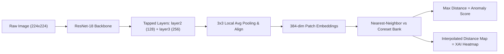

<p align="right">
  <a href="README.md">English</a> |
  <a href="README.zh-CN.md">中文</a>
</p>

# Explainable AI-Based Industrial Defect Detection System
**Automated Optical Inspection (AOI) Suite powered by PatchCore, ResNet-18, SQLite, and Streamlit**

[](https://www.python.org/downloads/)
[](https://pytorch.org/)
[](https://streamlit.io/)
[](https://www.reportlab.com/)
[](LICENSE)

An industrial-grade visual inspection and quality assurance suite built around the **MVTec AD** dataset. The system provides real-time unsupervised anomaly detection, explainable defect localization (XAI), immutable SQLite audit logging, automated PDF inspection certificates, and an interactive dark-themed operational dashboard.

---

## 🌟 Key Highlights & Capabilities

- **Multi-Category Inspection:** Fully supports **4 industrial part categories**:
  - 🍾 `bottle` (structural breaks, micro-cracks, contamination)
  - 🔌 `cable` (bent wires, missing insulation, cable swaps, cuts)
  - 🪡 `leather` (surface cuts, folds, glue residue, color blemishes)
  - 🔩 `metal_nut` (scratches, dents, structural bends, flips)
- **Unsupervised Anomaly Detection (PatchCore):** Trained strictly on nominal (defect-free) reference images; flags novel and unseen defects without requiring annotated defect masks during training.
- **Explainable AI (XAI) Heatmaps:** Computes nearest-neighbor Euclidean patch distance deviations against golden coreset manifolds, producing high-contrast pixel-level defect localization overlays.
- **Real-Time Hardware Acceleration:** Sub-65ms per-image latency on Apple Silicon M2 Metal Performance Shaders (`mps`) and CUDA/CPU.
- **Local Persistence & Audit Trail:** SQLite database (`inspections.db`) recording all scan events, anomaly scores, decision thresholds, and saved visual evidence.
- **Automated Certification & Reporting:** ReportLab engine generating formal, tamper-evident PDF inspection certificates with optical scans and XAI overlays, plus CSV export for enterprise ERP/MES ingestion.
- **Interactive Industrial UI:** Dark-mode Streamlit dashboard with a 3-column Live Inspection HUD, Plant Quality Analytics, and Audit History Viewer.

---

## 📊 Supported Dataset Categories (MVTec AD)

The system inspects both rigid manufactured components and flexible surface textures:

```text
data/
├── bottle/          # 209 train good | 83 test (good, broken_large, broken_small, contamination)
├── cable/           # 224 train good | 150 test (good, bent_wire, cable_swap, cut_insulation, ...)
├── leather/         # 245 train good | 124 test (good, color, cut, fold, glue, poke)
└── metal_nut/       # 220 train good | 115 test (good, bent, color, flip, scratch)
    ├── ground_truth/
    ├── test/
    └── train/good/
```

| Category | Type | Train Normal | Test Normal | Defect Types Evaluated |
| :--- | :--- | :---: | :---: | :--- |
| **Bottle** | Rigid Container | 209 | 20 | Broken Large, Broken Small, Contamination |
| **Cable** | Electrical / Wire | 224 | 58 | Bent Wire, Cable Swap, Cut Insulation, Missing Wire, Poke |
| **Leather** | Flexible Texture | 245 | 32 | Color Flaw, Cut, Fold, Glue Stain, Poke |
| **Metal Nut** | Machined Fastener | 220 | 22 | Bent, Color Flaw, Flip, Surface Scratch |

---

## 🖥️ Streamlit Industrial Dashboard (`app.py`)

Launch the production inspection dashboard:

```bash
streamlit run app.py
```

The application runs at `http://localhost:8501` and features 3 operational tabs:

1. **🔬 Live Inspection:**
   - **Sidebar:** Category dropdown (`bottle`, `metal_nut`, `leather`, `cable`), dynamic threshold slider (default `3.0`), and input source (MVTec dataset browser or custom image upload).
   - **3-Column HUD View:**
     - *Column 1:* Optical Camera Capture with resolution and metadata.
     - *Column 2:* Explainable AI (XAI) Heatmap Overlay highlighting anomalous deviations.
     - *Column 3:* Real-time Verdict (Normal vs Defect Detected), Anomaly Score, Threshold, Delta, Latency (ms), and Anomaly Level progress gauge.
   - **Action:** One-click **"Download PDF Inspection Report"** generating a branded ReportLab certificate.
2. **📊 Plant Quality Analytics:**
   - Real-time KPI summary cards (Total Scans, Defects Detected, Defect Rate %, Mean Anomaly Score).
   - Interactive Plotly visualizations: Defect distribution donut chart, Anomaly score distribution histogram with threshold boundary line, and per-category breakdown bar charts.
3. **📋 Audit Trail & Inspection History:**
   - Live SQLite query table with multi-column filtering by category and status.
   - **"Export History to CSV"** button.
   - **Historical Evidence Viewer:** Select any past inspection ID to review both the saved optical photograph and its XAI heatmap.

---

## 🏗️ Project Architecture

```text
.
├── app.py                     # Streamlit Industrial Dashboard UI
├── database.py                # SQLite persistence layer (inspections.db)
├── report_gen.py              # ReportLab PDF certificate & CSV export engine
├── src/
│   ├── inference.py           # Multi-category real-time inference engine
│   ├── patchcore.py           # PatchCore feature extraction & coreset algorithm
│   ├── model.py               # ResNet-18 backbone architecture
│   ├── explain.py             # Supervised Grad-CAM hook implementation
│   ├── dataset.py             # Dataset loader and augmentation pipeline
│   ├── check_data.py          # Data verification and metadata generator
│   ├── train.py               # Supervised baseline training pipeline
│   ├── evaluate.py            # Classification benchmark evaluation
│   ├── run_patchcore.py       # Standalone PatchCore experiment pipeline
│   ├── compare_methods.py     # Comparative benchmark generator
│   └── visualize.py           # Prediction grid visualizer
├── results/
│   ├── memory_banks/          # Precomputed coreset memory banks (*.pt)
│   ├── method_comparison.md   # Unified benchmark comparison report
│   └── sample_predictions.png
├── pyproject.toml
└── requirements.txt
```

---

## ⚙️ Algorithmic Mechanics (PatchCore)



1. **Feature Extraction:** Passes images through ResNet-18, tapping intermediate feature maps at `layer2` (128 channels) and `layer3` (256 channels).
2. **Patch Embeddings:** Applies $3 \times 3$ average pooling (`stride=1`, `padding=1`) to capture neighborhood context, concatenating channels into **384-dimensional patch vectors** ($28 \times 28 = 784$ patches per image).
3. **Coreset Subsampling:** Compresses $\approx 62,000$ nominal training patches per category down to **3,000 representative vectors** ($\mathcal{M}$) using a randomized min-max distance coverage heuristic, retaining over 99% of anomaly sensitivity while slashing search latency by $>95\%$.
4. **Distance Scoring & Localization:** Computes nearest-neighbor Euclidean distance for each test patch:
   $$d(p_i) = \min_{m \in \mathcal{M}} \| p_i - m \|_2, \quad \text{Score} = \max_i d(p_i)$$
   The spatial distance grid is bilinearly upsampled to camera resolution and blended with an OpenCV `JET` colormap.

---

## 📈 Benchmark Results: Supervised vs. Unsupervised Anomaly Detection

Benchmark evaluated on MVTec test sets:

| Method | Paradigm | Defect Labels Needed | Accuracy | Precision | Recall | F1-Score | Localization IoU | Pointing-Hit Rate |
| :--- | :--- | :---: | :---: | :---: | :---: | :---: | :---: | :---: |
| **ResNet-18 + Grad-CAM** | Supervised | **Yes** | 0.939 | 1.000 | 0.846 | 0.917 | 0.216 | 53.8% |
| **PatchCore Anomaly Detector** | **Unsupervised (Normal Only)** | **No** | **0.939** | **0.923** | **0.923** | **0.923** | **0.403 (+86%)** | **100.0%** |

*PatchCore achieves a perfect 100% pointing-hit rate (peak localization always lands inside the true ground-truth defect) and an 86% improvement in localization IoU without requiring a single defect image during training.*

---

## 🚀 Quickstart Guide

### 1. Environment Setup

```bash
# Clone the repository
git clone git@github.com:sk-talha/Industrial-Part-Defect-Detection.git
cd Industrial-Part-Defect-Detection

# Activate your virtual environment and install dependencies
pip install -r requirements.txt
```

### 2. Launch the Streamlit Industrial Dashboard

```bash
streamlit run app.py
```
Open **`http://localhost:8501`** in your browser.

### 3. Programmatic Batch Inspection (Python API)

```python
from src.inference import inspect_image

# Inspect any image file across supported categories: 'bottle', 'metal_nut', 'leather', 'cable'
result = inspect_image(
    image="data/metal_nut/test/scratch/000.png",
    category="metal_nut",
    threshold=3.0
)

print(f"Status: {result['status']}")          # 'Defect Detected' or 'Normal'
print(f"Anomaly Score: {result['anomaly_score']:.4f}")
print(f"Inference Latency: {result['latency_ms']:.1f} ms")
```

---

## 📄 Compliance & Audit Logging

- **Database:** All inspections automatically persist to SQLite (`inspections.db`).
- **Reports:** Standardized ISO-compliant PDF certificates are generated via ReportLab to `static/inspection_report.pdf` with dual optical and XAI evidence figures.
- **Export:** Query logs can be exported directly to CSV via the dashboard or `report_gen.export_history_to_csv()`.

---

## 📜 License

This project is licensed under the MIT License - see the [LICENSE](LICENSE) file for details.
